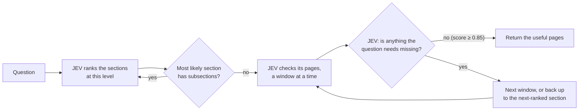

# Walking a PDF's table of contents with JEV

**Question.** Can a fast judgment model treat a long PDF's real table of contents
as a tree, walk it, and find the pages that answer a question while reading only
part of the document?

This is an experiment, not a finished system: it tests whether a decision model
can navigate a document the way a person would, by opening the contents, picking
the likeliest section, reading, and moving on until the answer is found. Every
part of it, from the prompts and stop rule to how pages are batched, can be
improved.

**Short answer.** Yes. On 20 questions over 4 long PDFs, all three approaches
returned pages that support the gold answer almost every time. They differ in
what that costs:

| | Answer supported | Pages read | Cost / question | Time / question |
|---|---:|---:|---:|---:|
| **JEV DFS** (tree walk) | 98% | 62 | **$0.0045** | **4.8 s** |
| Exhaustive JEV (every page) | 100% | 116 | $0.0056 | 5.3 s |
| Sol agent (LLM walks the tree) | 100% | **10** | $0.056 | 12.5 s |

- **Against Sol:** JEV DFS finds the answer in the same tree about 2.6× faster
  and about 12× cheaper, with no LLM choosing the path.
- **Against checking every page:** JEV DFS reads about half the pages and
  returns fewer pages that are not needed.
- **Sol** returns the fewest pages (1.4 per question) and reads the least, but
  each step is a slow, expensive LLM call.

[30-second video of one question](../assets/jev-three-ways.mp4) ·
[interactive report with every request and reply](report.html) ·
[generated summary](summary.md)

## The three approaches

All three get the same parsed pages, the same table of contents and the same
limits: at most 8 complete pages (12,000 tokens) per read and in the returned
evidence. Page text is never cut. No answer is written; each returns pages.

**JEV DFS** (the method under test)

Ranking only orders the walk; nothing is skipped for good, so if the evidence is
never judged complete the walk reaches every page.

**Exhaustive JEV** (what the tree saves): the same page checks over every page,
then keep the best-scoring pages. No ranking and no stop decision.

**Sol agent** (what JEV replaces): an OpenAI model walks the same tree itself.
Each turn it chooses descend, read, back up or finish, and it decides when to
stop. No JEV.

**What JEV is asked.** For each page, read with the page before and after as
context: *does this page state evidence needed for part of the question?* Pages
are returned only on their own score; the neighbours are context. When ranking
sections, JEV picks among the section titles. To decide whether to stop, it is
asked whether anything the question needs (for a ratio, each input separately) is
still missing from the selected pages.

## One question, step by step

*"How does Amazon recognize lease costs?"* Amazon 2017 annual report, 85 pages;
the annotated answer is page 47. One recorded run of each:

| | Steps | Requests | Pages read | Returned | Time | Cost |
|---|---|---:|---:|---|---:|---:|
| JEV DFS | Part II → Item 8 (Financial Statements) → Notes → check pages 41–48 → page 47 scores 0.94 → nothing missing (0.88) → stop | 5 | 8 | 46, **47** | 2.2 s | $0.0006 |
| Exhaustive JEV | 14 windows covering all 85 pages → page 47 scores 0.93 → keep the top 8 | 14 | 85 | **47** + 7 others | 5.0 s | $0.0050 |
| Sol agent | descend Part II → descend Item 8 → read Notes from page 42 → finish with page 47 | 4 | 8 | **47** | 13.3 s | $0.033 |

Sol took the same path as DFS. The difference is speed and cost: each Sol step
took about 3 s, each JEV request 0.2–0.7 s.

## How we evaluated

- **Documents:** 4 PDFs from
  [PageIndex-OSS-Benchmark](https://github.com/VectifyAI/PageIndex-OSS-Benchmark),
  chosen because each has a real printed table of contents: three annual reports
  (Amazon 2017, Best Buy 2023, Activision Blizzard 2019) and one coffee-machine
  manual, 75–198 pages each.
- **Questions:** 20 questions on those PDFs, each with a gold answer and
  annotated evidence pages. Eight are the benchmark's text-lookup questions; the
  other twelve are existing MMLongBench-Doc-V2 questions on the same PDFs, which
  add tables and answers computed from two pages. 11 questions are answered on
  one page; 9 need two (mostly ratios). All are answerable from the text.
  Listed in [`evaluation/cohort.json`](../../evaluation/cohort.json).
- **What is scored:** each approach returns pages; no answer is written. The
  gold answer and pages are used only after retrieval finishes. The main measure
  is whether the returned pages support the gold answer; annotated-page recall,
  precision, pages read, requests, cost and time are also recorded.
- **Repeats:** each JEV approach ran every question 3 times; Sol 1–2 times.
  Questions are weighted equally, so repeats measure variation, not extra
  questions.
- **Cost:** token counts × list prices pinned in `evaluation/pricing.py`
  (JEV $0.042 per million input tokens; Sol $2 per million input and $10 per
  million output tokens).

## Results

| Approach | Answer supported | Page recall | Pages read | Requests | Cost / question | Time / question | Pages returned | Precision |
|---|---:|---:|---:|---:|---:|---:|---:|---:|
| JEV DFS | 98% (59/60) | 98% | 62 | 15.5 | **$0.0045** | **4.8 s** | 5.3 | 36% |
| Exhaustive JEV | **100%** (60/60) | 98% | 116 | 16 | $0.0056 | 5.3 s | 7.3 | 20% |
| Sol agent¹ | **100%** (30/30) | 83% | **10** | **3** | $0.056 | 12.5 s | **1.4** | **88%** |

- **Answer supported:** share of runs whose returned pages contain everything
  needed for the question's gold answer. That is either every annotated page, or
  another page set checked to give the same answer (see below).
- **Page recall:** share of the annotated pages that were returned.
- **Precision:** share of returned pages that are annotated pages.
- **Pages read:** pages whose text a model saw, including neighbour context.
- Questions are weighted equally; time and requests are medians. Each JEV
  approach ran 3 times per question. Cost uses list prices pinned in
  `evaluation/pricing.py`.

¹ Sol: 30 completed runs covering all 20 questions (10 of them twice). Two more
runs failed for reasons outside the method (a network timeout, and running out of
OpenAI credit) and are left out. Sol's times come from a different session than
the JEV runs.

### Why page recall undercounts

The annotations mark where annotators found each answer, not every place it can
be found. Annual reports repeat figures: operating income appears in the income
statement and in the discussion of results, and interest expense appears in two
notes. Sol picks the smallest set of pages that answers the question, so it often
returns a different but equally valid page. For example:

| Question | Gold answer | Annotated pages | Sol returned | From Sol's pages |
|---|---|---|---|---|
| Best Buy return on capital employed | 0.263 | 25, 39 | 39, 40 | 1,795 ÷ (15,803 − 8,979) = 0.263 |
| Activision R&D ÷ assets | 5.03% | 47, 69 | 30, 47 | 998 ÷ 19,845 = 5.03% |
| Activision interest coverage | 17.85 | 70, 114 | 41, 98 | 1,607 ÷ (86 + 4) = 17.86 |
| Amazon cash ÷ total liabilities | 0.198 | 40, 50 | 40 | every input is on page 40 |
| Amazon cost of sales components | list | 44 | 27 | the same sentence appears on page 27 |

Each accepted page set, with the source excerpt, is recorded in
[`evaluation/evidence-review.json`](../../evaluation/evidence-review.json), and
the report builder checks every excerpt against the page text.

### Where JEV DFS misses

One of 60 runs: Activision interest coverage. DFS returned operating income but
no page with the interest expense, and judged nothing was missing. The stop check
is what makes the walk complete on two-page questions, and it has a cost: in 20
of 60 runs DFS never became sure enough and walked the whole document, which is
why it reads 62 pages on average rather than a single section. On one-page
questions it found the answer in every run.

Those full walks cost about 1.5× checking every page on the same question
(1.1–2×). DFS reads one section at a time, so its page batches are smaller and
re-read more neighbouring pages at section edges, and the stop question adds
about 17% of its tokens. Merging small neighbouring sections into full batches
would narrow the gap.

## What this does and does not show

- It shows that, on these documents, a fast judge can steer a table-of-contents
  walk to the evidence as reliably as an LLM agent, at a fraction of the time and
  cost.
- It does not show the best retrieval method in general. There is no baseline
  without the tree (for example, embedding search), and only 20 questions on 4
  documents with clean, real tables of contents.
- The alternative page sets were checked by the assistant against the gold
  answers, not by independent reviewers.
- Answers are not generated. "Answer supported" means the returned pages contain
  the inputs, not that a model would compute the answer correctly from them.
- Times run from the question to the returned pages, with each retrieval sending
  one request at a time. They include network and API latency, which varied
  between sessions; costs and pages read are the more stable comparison.
  Exhaustive checks could run in parallel in a real system and finish sooner at
  the same cost.
- The stop cutoff (0.85) was set on these same questions, so the DFS numbers may
  be slightly optimistic.

## Setup

- JEV model `jev-1.13.0` (TypeSafe); Sol model `gpt-6.1-sol` (OpenAI Responses API).
- PDFs parsed with Datalab; the printed table of contents is matched to physical
  pages. Pages the table of contents does not cover become their own branches,
  so every page is reachable.
- Reproduce: `python -m evaluation.run_repeated --output-dir <dir> --parallel 4`,
  then `python -m reporting.build_cohort_report --runs <dir> --output … --summary …`
  (see `evaluation/README.md`).
