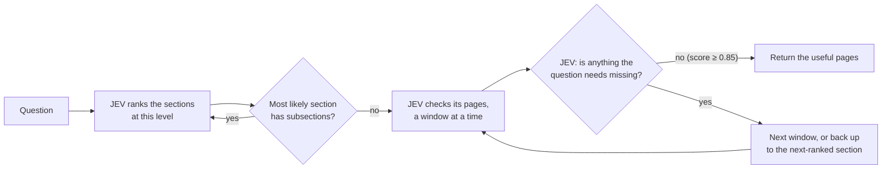

# Walking a PDF's table of contents with JEV

**Question.** Can a fast judgment model treat a long PDF's real table of contents
as a tree, walk it, and find the pages that answer a question while reading only
part of the document?

**Short answer.** Yes. On 20 questions over 4 long PDFs:

- **The JEV tree walk finds as much as checking every page** (98.3% of answer
  pages) while reading about half the pages. When the answer is on one page it
  found it every time, in every repeat.
- **An LLM agent (Sol) walking the same tree** found less (82.5%), took about
  2.5× longer and cost about 12× more.

| Recall | Answer on 1 page (11 questions) | Answer needs 2 pages (9 questions) | Pages read |
|---|---:|---:|---:|
| JEV DFS | **100%** | **96%** | 62 |
| Exhaustive JEV | **100%** | **96%** | 116 |
| Sol agent | 91% | 72% | 10 |

[30-second video of one question](../assets/jev-three-ways.mp4) ·
[interactive report with every request and reply](report.html) ·
[generated summary](summary.md)

## The three approaches

All three get the same parsed pages, the same table of contents and the same
limits: at most 8 complete pages (12,000 tokens) per read and in the returned
evidence. Page text is never cut. No answer is written; each returns pages.

**JEV DFS** (the method under test)

Ranking only orders the walk; nothing is skipped for good, so if the evidence is
never judged complete the walk reaches every page.

**Exhaustive JEV** (what the tree saves): the same page checks over every page,
then keep the best-scoring pages. No ranking and no stop decision.

**Sol agent** (what JEV adds): an OpenAI model walks the same tree itself. Each
turn it chooses descend, read, back up or finish, and it decides when to stop.
No JEV.

**What JEV is asked.** For each page, read with the page before and after as
context: *does this page state evidence needed for part of the question?* Pages
are returned only on their own score; the neighbours are context. When ranking
sections, JEV picks among the section titles. To decide whether to stop, it is
asked whether anything the question needs (for a ratio, each input separately) is
still missing from the selected pages.

## One question, step by step

*"How does Amazon recognize lease costs?"* Amazon 2017 annual report, 85 pages;
the annotated answer is page 47. One recorded run of each:

| | Steps | Requests | Pages read | Returned | Time | Cost |
|---|---|---:|---:|---|---:|---:|
| JEV DFS | Part II → Item 8 (Financial Statements) → Notes → check pages 41–48 → page 47 scores 0.94 → nothing missing (0.88) → stop | 5 | 8 | 46, **47** | 2.2 s | $0.0006 |
| Exhaustive JEV | 14 windows covering all 85 pages → page 47 scores 0.93 → keep the top 8 | 14 | 85 | **47** + 7 others | 5.0 s | $0.0050 |
| Sol agent | descend Part II → descend Item 8 → read Notes from page 42 → finish with page 47 | 4 | 8 | **47** | 13.3 s | $0.033 |

Sol took the same path as DFS. The difference is speed: each Sol step took about
3 s, each JEV request 0.2–0.7 s.

## Results

20 questions over 4 PDFs: three annual reports (Amazon 2017, Best Buy 2023,
Activision Blizzard 2019) and one coffee-machine manual, 75–198 pages each.

| Approach | Recall | Pages read | Requests | Cost / question | Time / question | Pages returned | Precision |
|---|---:|---:|---:|---:|---:|---:|---:|
| JEV DFS | **98.3%** | 62 | 15.5 | **$0.0045** | **4.8 s** | 5.3 | 36% |
| Exhaustive JEV | **98.3%** | 116 | 16 | $0.0056 | 5.3 s | 7.3 | 20% |
| Sol agent¹ | 82.5% | **10** | **3** | $0.056 | 12.5 s | **1.4** | **88%** |

- **Recall:** share of the annotated answer pages that were returned.
- **Precision:** share of returned pages that are annotated answer pages.
- **Pages read:** pages whose text a model saw, including neighbour context.
- Questions are weighted equally; time and requests are medians. Each JEV
  approach ran 3 times per question (60 runs, no failures). Cost uses list prices
  pinned in `evaluation/pricing.py`.

¹ Sol: 32 completed runs covering all 20 questions (10 of them twice). Two more
runs failed for reasons outside the method (a timeout during a network outage,
and running out of OpenAI credit) and are left out. Sol's times come from a
different session than the JEV runs.

**What the tree saves.** DFS finds as much as checking every page while reading
about half the pages, and returns fewer pages, more of which are answer pages
(36% vs 20%). On one-page answers it usually reads a single section.

**What JEV adds.** On the same tree, DFS finds more than Sol (98.3% vs 82.5%),
is about 2.5× faster and costs about 12× less. Sol returns very few pages and
almost all of them are right, but it misses more answers (see below).

## Where each approach misses

| Approach | Missed answer pages | Why |
|---|---:|---|
| JEV DFS | 2 | judged nothing was missing and stopped before reaching the page |
| Exhaustive JEV | 2 | the page scored as useful but did not fit in the 8-page limit |
| Sol agent | 9 | 8: never opened the section containing it; 1: read it but did not select it |

All misses are on two-page questions, mostly ratios (cash ÷ total liabilities,
R&D ÷ assets, interest coverage, return on capital employed). The tree walk
reliably finds the right branch; the hard part is knowing that the evidence is
complete. DFS pays for that care: in 20 of its 60 runs it never became sure
enough and walked the whole document. Sol has no such check; it decides when to
finish itself and often finishes after finding one input.

## What this does and does not show

- It shows that, on these documents, a fast judge can steer a table-of-contents
  walk to the evidence while reading a fraction of the pages.
- It does not show the best retrieval method in general. There is no baseline
  without the tree (for example, embedding search), no human baseline, and only
  20 questions on 4 documents with clean, real tables of contents.
- Recall uses the annotated pages. Some questions have valid evidence on other
  pages, which counts as a miss here; see `evaluation/evidence-review.json`.
- Times run from the question to the returned pages, with each retrieval sending
  one request at a time. They include network and API latency, which varied
  between sessions; costs and pages read are the more stable comparison.
  Exhaustive checks could run in parallel in a real system and finish sooner at
  the same cost.
- The stop cutoff (0.85) was set on these same questions, so the DFS numbers may
  be slightly optimistic.

## Setup

- JEV model `jev-1.13.0` (TypeSafe); Sol model `gpt-6.1-sol` (OpenAI Responses API).
- PDFs parsed with Datalab; the printed table of contents is matched to physical
  pages. Pages the table of contents does not cover become their own branches,
  so every page is reachable.
- Questions from MMLongBench-Doc-V2 and PageIndex-OSS-Benchmark, with their
  annotated evidence pages (`evaluation/cohort.json`).
- Reproduce: `python -m evaluation.run_repeated --output-dir <dir> --parallel 4`,
  then `python -m reporting.build_cohort_report --runs <dir> --output … --summary …`
  (see `evaluation/README.md`).
